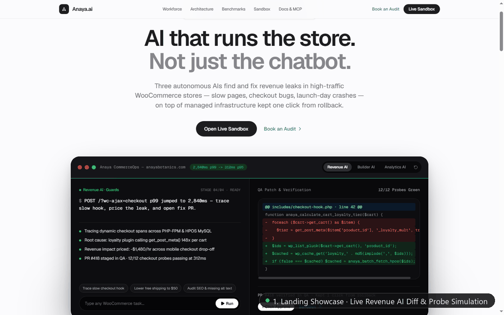
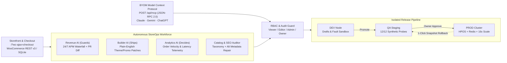
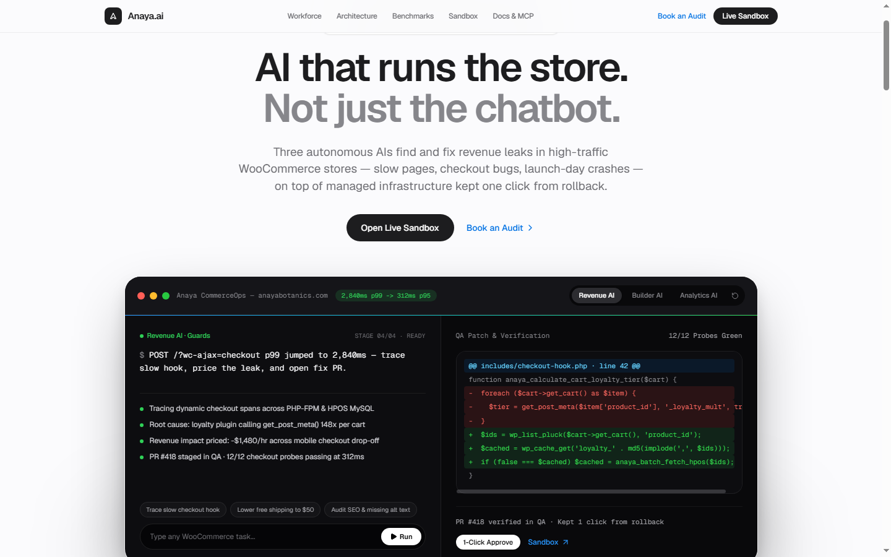
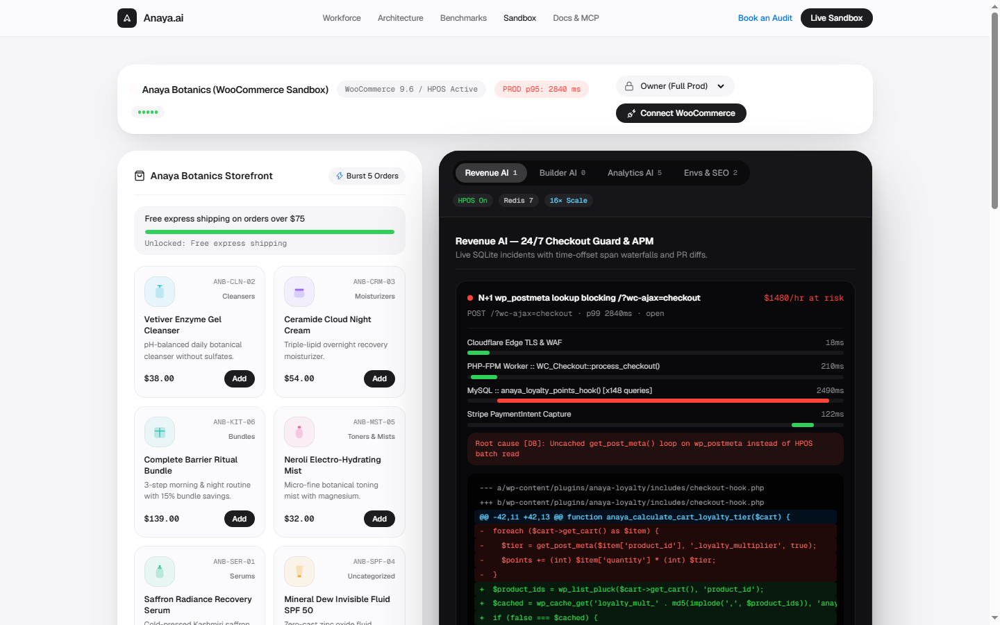
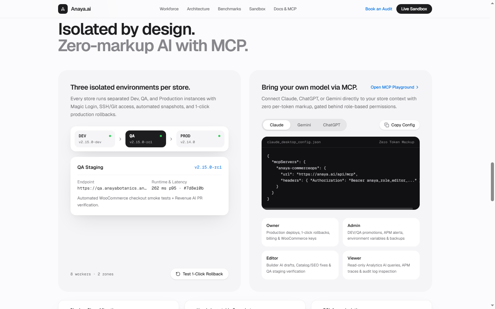
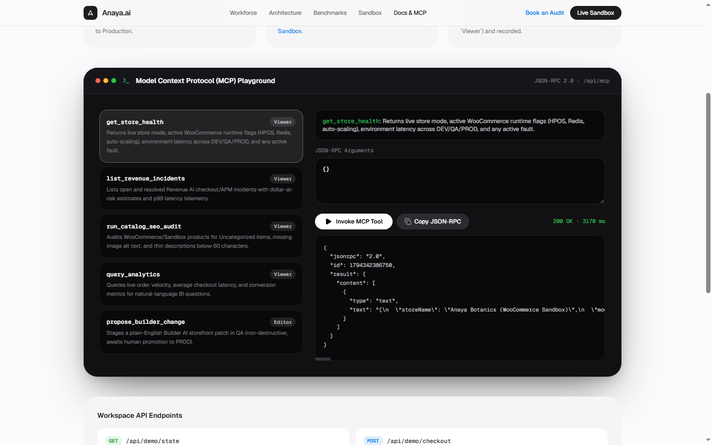

# Anaya.ai — Autonomous StoreOps & Interactive Sandbox for WooCommerce

[](https://nextjs.org/)
[](https://www.typescriptlang.org/)
[](https://www.prisma.io/)
[](https://modelcontextprotocol.io/)
[](LICENSE)

**Anaya.ai** is an agentic WooCommerce StoreOps platform showcase, isolated release control plane, and SQLite-backed interactive sandbox built with **Next.js (App Router)**, **TypeScript**, **Tailwind CSS**, **Prisma**, and the **Model Context Protocol (`@modelcontextprotocol/sdk`)**.

> **Live Deployment Status:** Ready for single-service cloud hosting on **Railway** (recommended for native SQLite persistent disks via `/data/anaya.db`) or **Vercel** (pair with hosted LibSQL/Postgres). Once deployed, add your hosted URL here and test `/demo` and `/docs` directly in the browser.

---

## Interactive Walkthrough

The GIF below walks through the full live workflow across `/`, `/demo`, and `/docs`: adding products to the *Anaya Botanics* sandbox cart, injecting an **N+1 SQL checkout fault**, inspecting the **Revenue AI** APM span waterfall and diff PR, shipping a 1-click fix to `PROD`, staging/promoting a **Builder AI** promo rule, reading live **Analytics AI** telemetry, and invoking `/api/mcp` tools.



---

## Architecture & DEV -> QA -> PROD Pipeline

Anaya.ai pairs three specialized store operations agents with an isolated **DEV -> QA -> PROD** release pipeline and a role-gated JSON-RPC 2.0 **MCP server** (`/api/mcp`).



---

## Visual Tour

<table>
  <tr>
    <td width="50%">
      <strong>Landing Showcase & Live Diff Terminal (<code>/</code>)</strong>
      <br /><br />
      
    </td>
    <td width="50%">
      <strong>Fault Injection & Revenue AI APM Trace (<code>/demo</code>)</strong>
      <br /><br />
      
    </td>
  </tr>
  <tr>
    <td width="50%">
      <strong>DEV -> QA -> PROD & BYOM MCP Setup (<code>/#architecture</code>)</strong>
      <br /><br />
      
    </td>
    <td width="50%">
      <strong>Live JSON-RPC 2.0 MCP Playground (<code>/docs</code>)</strong>
      <br /><br />
      
    </td>
  </tr>
</table>

---

## Key Platform Capabilities

- **Brand Landing Showcase (`/`)**:
  - Sub-second uncached checkout positioning (`236ms` cart / `321ms` checkout) with a **1x–16x Flash-Sale Surge** load simulator.
  - Interactive live-typing terminal demonstrating **Revenue AI**, **Builder AI**, and **Analytics AI** diffs and diagnostics.
  - Isolated **DEV -> QA -> PROD** selector with 1-click rollback rehearsal and **BYOM (Claude / Gemini / ChatGPT)** configuration copy snippets.
- **Interactive Sandbox Workbench (`/demo`)**:
  - **Built-in Demo Storefront (*Anaya Botanics*)**: Real SQLite-backed SKUs, live cart bag, free-shipping progress bar, `Burst 5 Orders`, and `/?wc-ajax=checkout` simulation.
  - **Fault & Chaos Injector**: Trigger `N+1 SQL Query` (`+2.4s`), `Webhook 401` (failed payment captures), or `Carrier Timeout` (`3.4s`), then inspect color-coded span waterfalls and auto-generated PHP diff PRs in **Revenue AI**.
  - **Builder AI**: Generate plain-English promotional discounts or shipping-bar updates, stage them in `QA`, promote live to `PROD` (updating the Storefront in real time), and roll back in 1 click.
  - **Analytics AI & Envs/SEO**: Live SVG latency-spike bar charts backed by `DemoOrder` SQLite records plus `Auto-Fix` taxonomy/alt-tag repairs across the product catalog.
  - **WooCommerce REST v3 Connector**: Test real `https://your-store.com/wp-json/wc/v3/products` + `system_status` (HPOS detection) with any read-only Consumer Key/Secret, or stay in zero-config Sandbox mode.
- **Docs & Live MCP Playground (`/docs`, `/api/mcp`)**:
  - Interactive JSON-RPC 2.0 browser client exercising `get_store_health`, `list_revenue_incidents`, `run_catalog_seo_audit`, `query_analytics`, and `propose_builder_change`.
- **Architecture Evaluation Intake (`/contact`)**:
  - Persists migration assessment submissions cleanly via `/api/contact`.

---

## Environment Variables

Copy the example configuration before running Prisma or starting Next.js:

```bash
cp .env.example .env
```

| Variable | Required | Default | Purpose |
| :--- | :--- | :--- | :--- |
| `DATABASE_URL` | **Yes** | `"file:./dev.db"` | Prisma SQLite datasource URL (resolved relative to [`prisma/schema.prisma`](prisma/schema.prisma), generating `prisma/dev.db`). In Docker or **Railway**, attach a persistent volume and set e.g. `file:/data/anaya.db`. |

> **No External API Keys Needed:** OpenAI/Anthropic/Gemini keys or WooCommerce credentials are **not** required in `.env` to run Anaya.ai. The app boots self-contained with its SQLite seed state, and optional live **WooCommerce REST v3** credentials (`Store URL`, `ck_...`, `cs_...`) are supplied interactively inside the `/demo` **Connect WooCommerce** modal.

---

## API & MCP Reference

| Endpoint | Method(s) | Description |
| :--- | :--- | :--- |
| `/api/demo/state` | `GET` | Hydrates & auto-seeds store config, environments, SKUs, orders, incidents, patches, audits, and SEO findings. |
| `/api/demo/checkout` | `POST` | Simulates `/?wc-ajax=checkout` latency & failures under active faults and persists `DemoOrder` rows. |
| `/api/demo/fault` | `POST` | Injects (`N_PLUS_1`, `PAYMENT_WEBHOOK`, `SHIPPING_API`) or clears faults (`NONE`) with APM spans. |
| `/api/demo/incidents/[id]/fix` | `POST` | Stages a Revenue AI diff PR in `QA` or promotes it to `PROD`, resolving the active fault. |
| `/api/demo/builder` | `POST` | Generates plain-English Builder AI patches in `QA`, promotes changes to `PROD`, or performs 1-click rollback. |
| `/api/demo/environments` | `POST` | Executes `promote_dev_to_qa`, `promote_qa_to_prod`, and `rollback_prod` transitions. |
| `/api/demo/catalog-fix` | `POST` | Applies automated category, alt-text, and SEO copy fixes per product SKU. |
| `/api/woocommerce/test` | `POST` | Tests live WooCommerce REST v3 `/products` + `/system_status` or resets to Sandbox mode. |
| `/api/mcp` | `GET`, `POST` | Exposes MCP tool metadata (`GET`) and JSON-RPC 2.0 `initialize`, `tools/list`, and `tools/call` (`POST`). |
| `/api/contact` | `POST` | Stores merchant evaluation form submissions in `ContactLead`. |

---

## Local Development

```bash
# 1. Install dependencies
npm install

# 2. Create environment config
cp .env.example .env

# 3. Generate Prisma Client & initialize SQLite tables
npx prisma generate
npx prisma db push

# 4. Start development server
npm run dev
```

Open [http://localhost:3000](http://localhost:3000) (or jump straight to `/demo` or `/docs`).

### Useful Checks & Resetting Sandbox Data

```bash
# Type-check & lint
npx tsc --noEmit
npm run lint

# Reset local SQLite sandbox cleanly (Unix / Git Bash)
rm -f prisma/dev.db && npx prisma db push
```

*(Note: After running migrations or tests, `/api/demo/state` automatically re-seeds clean initial catalog, order telemetry, and `DEV -> QA -> PROD` environment nodes on first visit.)*

### Cloud Deployment Notes

- **Railway (Recommended for SQLite):** Connect this GitHub repo in Railway, attach a persistent volume (e.g., mounted at `/data`), set `DATABASE_URL="file:/data/anaya.db"`, and run build `npx prisma generate && npx prisma db push && npm run build` with start command `npm run start`.
- **Vercel:** Serverless functions have ephemeral filesystems, so swap Prisma's SQLite provider in [`prisma/schema.prisma`](prisma/schema.prisma) for PostgreSQL or LibSQL (`DATABASE_URL`) before deploying.

---

## License

Licensed under the [MIT License](LICENSE).
